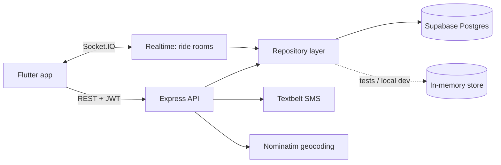

# AUC Rideshare


A carpooling platform for students and staff of the American University in Cairo: riders request rides, drivers accept them, and the rider follows the driver's location live.

Built as a team project for the Software Engineering course at AUC using Scrum (sprint planning, daily stand-ups, retrospectives).

**Stack:** Node.js · Express 5 · Socket.IO · Supabase (PostgreSQL) · JWT · Zod · Vitest · Docker · GitHub Actions · Flutter

## Features

- **Accounts:** registration with AUC ID, bcrypt-hashed passwords, JWT login, SMS phone verification
- **Rides:** request → accept → complete or cancel, with a guard against two drivers accepting the same ride
- **Live tracking:** the assigned driver streams their location to the rider over Socket.IO
- **Ratings:** rider and driver rate each other once per completed ride; profiles show the average
- **Friends:** send, accept and decline friend requests
- **Location:** reverse geocoding of a user's last position (OpenStreetMap Nominatim)

## Architecture



Routes never touch the database directly; they go through a repository with two implementations: Supabase for production, in-memory for tests and local development. That makes the API runnable and fully testable without a database.

## Run it

```bash
cd backend
npm install
npm run dev          # http://localhost:3000, in-memory data, SMS codes printed to the console
npm test             # 37 tests
```

Or with Docker:

```bash
docker build -t auc-rideshare-api backend
docker run -p 3000:3000 -e JWT_SECRET=change-me -e SMS_PROVIDER=textbelt -e TEXTBELT_KEY=... auc-rideshare-api
```

### Use Supabase

1. Create a Supabase project and run [`backend/supabase/migrations/0001_init.sql`](backend/supabase/migrations/0001_init.sql) in the SQL editor.
2. Copy `backend/.env.example` to `backend/.env` and set `SUPABASE_URL` and `SUPABASE_SERVICE_ROLE_KEY`.

Row-level security is enabled on every table with no public policies, so only the backend (service-role key) can read or write data.

## API

All routes except auth require `Authorization: Bearer <token>`.

| Method | Path | Who | Description |
|---|---|---|---|
| POST | `/api/auth/register` | anyone | Create account, returns token |
| POST | `/api/auth/login` | anyone | AUC ID + password, returns token |
| POST | `/api/auth/send-sms-code` | anyone | Send a 6-digit code to a registered phone |
| POST | `/api/auth/verify-sms-code` | anyone | Verify the phone |
| POST | `/api/rides` | rider | Request a ride |
| GET | `/api/rides/available` | driver | Open ride requests |
| GET | `/api/rides/current` | any | My active ride |
| GET | `/api/rides/:id` | participant | Ride details |
| POST | `/api/rides/:id/accept` | driver | Accept a requested ride |
| POST | `/api/rides/:id/cancel` | participant | Cancel |
| POST | `/api/rides/:id/complete` | assigned driver | Complete |
| POST | `/api/rides/:id/rating` | participant | Rate the other person, 1–5 |
| GET | `/api/friends` | any | My friends |
| GET | `/api/friends/requests` | any | Pending requests to me |
| POST | `/api/friends/requests` | any | Send a request |
| POST | `/api/friends/requests/:id/accept` · `/decline` | receiver | Answer a request |
| GET | `/api/users/me` | any | My profile and rating |
| GET | `/api/users/:aucId/rating` | any | A user's average rating |
| POST | `/api/users/me/location` | any | Update my location |

**Socket.IO** (connect with `auth: { token }`): `join-ride` (participants only), `driver-location` (assigned driver only), and server events `ride-requested`, `ride-updated`, `location-update`.

## What changed from the course version

The course version of the backend lives in the original team repository. This version keeps its features and data model and fixes the problems found in review:

| Area | Before | Now |
|---|---|---|
| Login | AUC ID + phone number, no password, no session | bcrypt password + JWT; banned users rejected |
| Authorization | User IDs taken from the request body, so anyone could act as anyone | Identity from the token; role and ownership checks on every route |
| Complete ride | Crashed (undefined `driverId`, response sent twice) | Fixed; only the assigned driver can complete |
| Accepting rides | Two drivers could race | Compare-and-set on status; tested concurrently |
| Ratings | `PUT /update-rating` let anyone overwrite any rating | Per-ride ratings by participants, averaged |
| SMS verification | Code returned in the API response | Code only sent by SMS, hashed, 5-min expiry, 5-attempt lock |
| Secrets | `.env` with API keys committed | `.env.example` only; keys removed; RLS on all tables |
| Notifications route | Referenced an undefined `app`, could not load | Removed; real-time updates go through Socket.IO |
| Project setup | No `package.json`, code duplicated in zip files | Installable package, tests, linting, Docker, CI |

## Team

| Name | GitHub |
|---|---|
| Kareem Sayed | [@kareems394](https://github.com/kareems394) |
| Mai Mahmoud | [@maimahmoud4](https://github.com/maimahmoud4) |
| Jana Elfeky | [@JanaElfeky](https://github.com/JanaElfeky) |
| Shahd Yasser | [@shahdyasser1654](https://github.com/shahdyasser1654) |

Original repository: [maimahmoud4/SWE-rideshare](https://github.com/maimahmoud4/SWE-rideshare). Course deliverables (requirements, architecture, design specification, use cases) are in [`docs/`](docs/). The Flutter screens are in [`frontend/`](frontend/).
